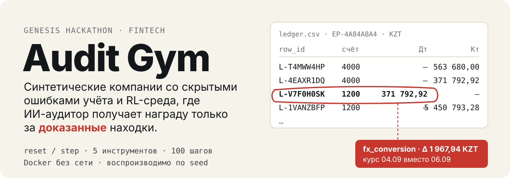
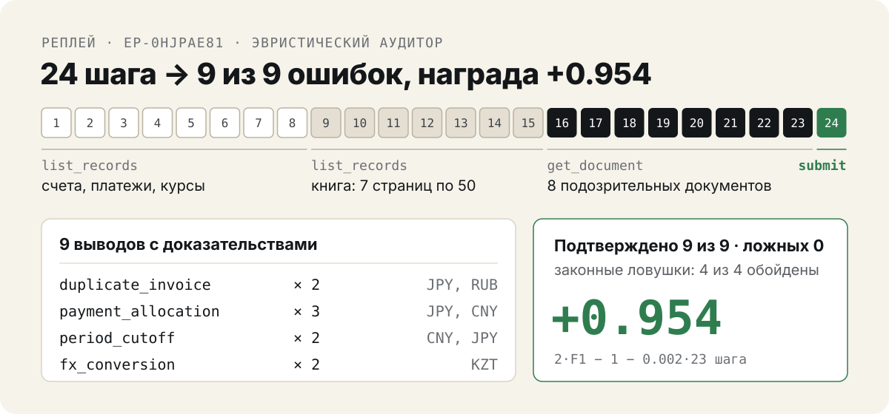
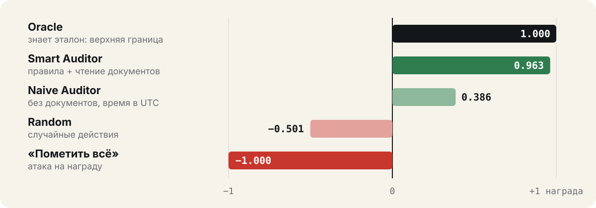
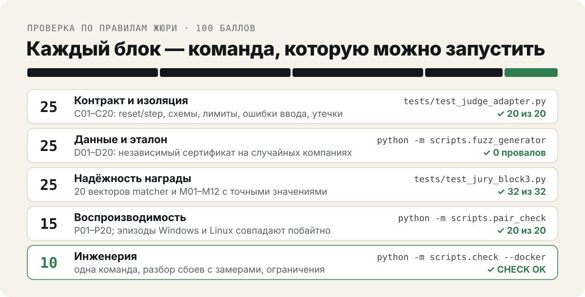
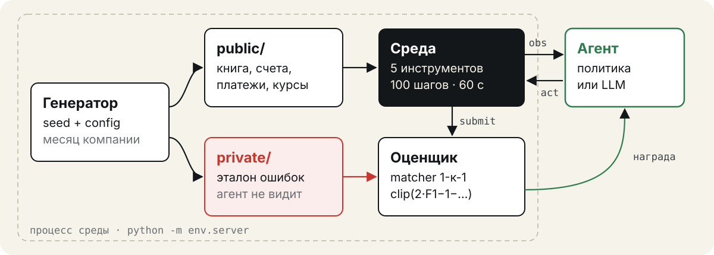

<p align="center">
  
</p>

<p align="center">
  <a href="https://github.com/mrzero-gh/The-best-Viber-coders/actions/workflows/ci.yml"></a>
  
  
  
  <a href="LICENSE"></a>
</p>

<p align="center">
  <a href="docs/DESCRIPTION.md"><b>Описание на 1 страницу</b></a> ·
  <a href="docs/design.md">Записка о дизайне</a> ·
  <a href="docs/judge_adapter.md">Адаптер жюри</a> ·
  <a href="docs/contract.md">Контракт</a>
</p>

**Audit Gym** — RL-среда в стиле Gymnasium для обучения ИИ-аудитора финансовых записей. Генератор создаёт месяц жизни вымышленной компании с ошибками учёта. Агент ищет их через инструменты и отправляет выводы с доказательствами. Оценщик сверяет их с закрытым эталоном и выдаёт награду, которую нельзя получить угадыванием.

## Агент в деле

<p align="center">
  
</p>

Настоящая траектория из [`trajectories.jsonl`](trajectories.jsonl). Пошаговый реплей в терминале: `python -m scripts.replay --episode EP-0HJPAE81`.

## Результат: награду нельзя обмануть

<p align="center">
  
</p>

Средняя награда по 4 сценариям `python -m scripts.jury`: чистая компания, одиночные ошибки, совмещённые сценарии, полный комплекс.

| Политика | F1 | Награда | Шаги | Почему так |
|---|---:|---:|---:|---|
| Oracle | 1.000 | 1.000 | 1.0 | знает эталон: задача разрешима |
| Smart Auditor | 1.000 | 0.963 | 19.4 | открывает документы, учитывает часовой пояс и счёт 2900 |
| Naive Auditor | 0.704 | 0.386 | 15.6 | путает законные операции с ошибками |
| Random | 0.250 | −0.501 | 3.0 | F1 > 0 только на чистой компании |
| «Пометить всё» | 0.000 | −1.000 | 2.0 | ловушки есть даже в чистых компаниях |

## Проверка по правилам жюри

<p align="center">
  
</p>

Подключение по [определениям проверок FinTech](https://genesis-exe.com/fintech-checks.html): [`judge_adapter.py`](judge_adapter.py) с `generate_episode`, `make_env`, `score_episode`. Как включить каждый сценарий D01–D20 в конфиге — в [docs/judge_adapter.md](docs/judge_adapter.md).

**Проверено на скрытых значениях.** Жюри скрывает seed, валюты, часовой пояс и размеры, поэтому генератор проверен на случайных:
- **Любая компания.** База и 1–6 валют, в том числе без копеек (JPY, KRW) и с тремя знаками (KWD, BHD), пояс от −12:00 до +14:00: все сценарии вносятся и проходят независимый сертификат. `tests/test_any_company.py`, `python -m scripts.fuzz_generator`.
- **Любая платформа.** 20 эпизодов, собранных на Windows, пересобираются в Linux-контейнере байт в байт: `tests/test_committed_episodes.py` внутри `python -m scripts.check --docker`.
- **Любой размер.** Узкие диапазоны строк и документов: `python -m scripts.size_sweep`.
- **Любые действия.** Случайные и мусорные запросы к среде: `python -m scripts.fuzz_env`.

Каждый найденный сбой — с замером до и после и тестом-стражем: [docs/design.md, раздел 6.5](docs/design.md#65-найденные-и-исправленные-сбои-генератора).

<details>
<summary><b>Где что проверяется</b></summary>

| Блок жюри | Баллы | Наша проверка |
|---|---:|---|
| Контракт среды C01–C20 | 25 | `tests/test_judge_adapter.py`, `tests/test_isolation_speed.py`, `tests/test_env_server.py` |
| Закрытые эпизоды D01–D20 | 25 | `judge_adapter.generate_episode` + независимый сертификат `grader.certificate` |
| Matcher и награда | 25 | `tests/test_jury_block3.py`: 20 векторов и M01–M12 |
| Парные проверки P01–P20 | 15 | `python -m scripts.pair_check` → 20/20 |
| Инженерия | 10 | `python -m scripts.check --docker` |

Ответы на 5 вопросов жюри и галерея атак на награду — в [записке о дизайне](docs/design.md#64-ответы-на-5-вопросов-жюри).

</details>

## Что внутри эпизода

Баланс Дт = Кт сходится даже после внесения ошибок, поэтому найти их можно только сверкой с первичными документами.

| Ошибка | Как выглядит в данных |
|---|---|
| `duplicate_invoice` | Два одинаковых счёта с разницей в несколько дней, оба проведены |
| `payment_allocation` | Платёж закрывает счёт целиком, а в книге разнесена лишь часть, остаток на 2900 |
| `fx_conversion` | Проводка посчитана по курсу другой даты или искажённому курсу |
| `period_cutoff` | Документ датирован вне отчётного месяца, а проведён внутри |

Ещё есть два **совмещённых сценария** (две ошибки на одних записях) и четыре вида **законных ловушек**, похожих на ошибки:
- `split_payment`: счёт оплачен частями;
- `refund`: возврат;
- `legit_recurring`: одинаковые счета за разные месяцы;
- `late_evening_local`: документ в 23:xx последнего дня по местному времени.

Размер настраивается: 200–2000 проводок и 20–200 документов. Каждый тип ошибки включается отдельно.

## Как устроено

<p align="center">
  
</p>

- **Генератор** (`generator/`): детерминированный по `seed`; ID генерируются из отдельного потока, поэтому смена ID не меняет содержание.
- **Среда** (`env/`): отдельный процесс `env.server`, протокол по одной JSON-строке на сообщение. Инструменты `list_records`, `get_record`, `get_document`, `calculator` (без `eval`) и `submit`.
- **Оценщик** (`grader/`): максимальное паросочетание выводов и ошибок с точным сравнением ID, валюты и суммы в пределах допуска. Награда `clip(2·F1 − 1 − 0.002·шаги, −1, 1)`.
- **Изоляция:** эталон не попадает в наблюдения, ошибки и траектории. Это проверяют метки-канарейки (`tests/test_leaks.py`).

## Быстрый старт

Одна команда проверяет всё — в изолированном контейнере (без сети, только чтение, не от root, 2 CPU / 4 ГБ):

```bash
python -m scripts.check --docker
```

Без Docker, в виртуальном окружении:

```bash
python -m venv .venv
source .venv/bin/activate          # Windows: .venv\Scripts\activate
pip install -r requirements.txt -r requirements-dev.txt
python -m scripts.check            # все тесты одной командой
```

Посмотреть, как работает агент:

```bash
python -m scripts.replay --episode EP-0HJPAE81   # пошаговый реплей в терминале
python -m scripts.ui --open                      # веб-дашборд на localhost:8080
python -m scripts.demo                           # демо на 3 минуты: тесты, жюри, парные проверки
python judge_adapter.py                          # самопроверка адаптера жюри
```

<details>
<summary><b>Все команды</b></summary>

| Команда | Что делает |
|---|---|
| `python -m scripts.check` | Все тесты (`--docker`: в контейнере без сети) |
| `python -m scripts.jury` | Прогон 5 политик с боевым оценщиком, таблица P/R/F1/награда/шаги |
| `python -m scripts.pair_check` | 20 парных проверок как у жюри |
| `python judge_adapter.py` | Самопроверка адаптера жюри |
| `python -m scripts.fuzz_generator --n 500` | Случайные конфиги генератора: сертификат, oracle, копия со сменой ID |
| `python -m scripts.fuzz_env` | Случайные и мусорные действия среды: ядро, сервер, сырой протокол |
| `python -m scripts.size_sweep` | Узкие диапазоны размера эпизода |
| `python -m scripts.plot_complexity` | Кривая сложности → `docs/complexity_curve.png` (нужен `pip install -r requirements-plot.txt`) |
| `python -m scripts.test_metamorphic` | Метаморфные проверки инвариантов |
| `python -m scripts.collect_episodes` | Пересборка 10 train + 10 dev эпизодов и траекторий |
| `python -m generator.explain <эпизод>` | История каждой ошибки эпизода |
| `python -m scripts.replay --list` | Список эпизодов в траекториях |
| `python -m scripts.ui --export docs/audit_ui.html` | Автономный HTML-дашборд |

</details>

<details>
<summary><b>Кривая сложности</b></summary>


| Уровень | Oracle | Smart Auditor | Naive Auditor | «Пометить всё» | Random |
|---|---:|---:|---:|---:|---:|
| 1. Чистая | 1.000 | 1.000 | 1.000 | 0.000 | 1.000 |
| 2. Простая | 1.000 | 1.000 | 1.000 | 0.000 | 0.000 |
| 3. Средняя | 1.000 | 1.000 | 1.000 | 0.000 | 0.000 |
| 4. Сложная | 1.000 | 1.000 | 0.889 | 0.000 | 0.000 |
| 5. Эксперт | 1.000 | 1.000 | 0.900 | 0.000 | 0.000 |

</details>

<details>
<summary><b>Структура репозитория</b></summary>

| Путь | Назначение |
|---|---|
| `generator/` | Компании, 4 типа ошибок, совмещённые сценарии, ловушки, `explain` |
| `env/`, `common/` | Среда `AuditEnv`, сервер, калькулятор |
| `grader/` | Matcher, награда, сертификат разрешимости |
| `policies/` | Oracle, RuleBased (Smart/Naive), FlagAll, Random |
| `schemas/` | JSON-схемы Draft 2020-12 |
| `episodes/`, `trajectories.jsonl` | 10 train + 10 dev эпизодов с отпечатками и траектории политик |
| `scripts/` | Проверка, жюри, парные проверки, фаззы и свип размеров, демо, реплей, UI |
| `judge_adapter.py` | Интерфейс закрытой проверки жюри |
| `docs/` | Описание, записка о дизайне, контракт, данные |

</details>

## Ограничения

Модель учёта упрощена: нет НДС и пошлин, пять счетов, платёж закрывает счета только в своей валюте. Высокая награда в симуляторе подтверждает корректность расследования, но не пригодность модели для реального аудита без дообучения. Каждое из 14 ограничений — с тестом или командой, которые его воспроизводят: [docs/design.md, раздел 7](docs/design.md#7-честные-ограничения-системы).

## Документация

- [docs/DESCRIPTION.md](docs/DESCRIPTION.md) — описание проекта на одну страницу
- [docs/design.md](docs/design.md) — записка о дизайне: блоки жюри, matcher, разбор сбоев, атаки, ответы на 5 вопросов
- [docs/judge_adapter.md](docs/judge_adapter.md) — адаптер жюри: форматы, коды ошибок, сценарии D01–D20
- [docs/contract.md](docs/contract.md) — контракт среды: протокол, инструменты, лимиты
- [docs/DATA.md](docs/DATA.md) — данные эпизода, `truth.json`, `provenance.json`
- [CONTRIBUTING.md](CONTRIBUTING.md) — работа с Git

Команда **The Best Viber Coders**, Genesis Hackathon 2026. Лицензия [MIT](LICENSE).
