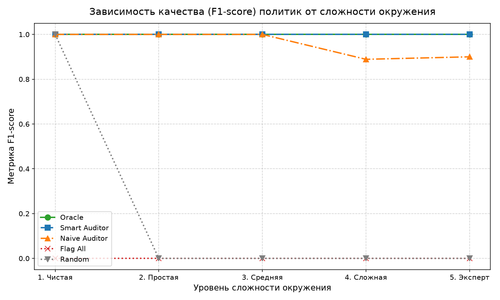

# Audit Gym — RL-среда для ИИ-аудитора

[](#быстрый-старт)
[](https://www.python.org/)
[](LICENSE)

Воспроизводимая RL-среда в стиле **Gymnasium** для обучения и оценки автономного ИИ-аудитора финансовых записей:
- **Генератор (A):** синтетические компании с выверенным бухгалтерским балансом, 4 типа скрытых ошибок, 2 совмещённых сценария и 4 типа легитимных отвлекающих случаев.
- **Среда (B):** изолированный процесс `env.server`, 5 регламентированных инструментов, бюджет 100 шагов, курсоры, безопасный калькулятор без `eval()`.
- **Оценщик (C):** детерминированное сопоставление находок 1-к-1 с эталоном, защита от читов и галерея атак, расчёт $Precision / Recall / F_1$ и награды.
- **Политики и инженерия (D):** 4 базовые политики, траектории train/dev эпизодов, метаморфные тесты, самопроверка `scripts.jury` и график сложности.

---

## Быстрый старт

### 1. Локальный запуск (Python 3.11+)

```powershell
python -m venv .venv
.venv\Scripts\activate
pip install -r requirements.txt -r requirements-dev.txt

# Единая команда проверки (642 теста)
python -m scripts.check
```

### 2. Запуск в Docker (изолированный режим без сети)

Проверка как у жюри, одной командой:

```
python -m scripts.check --docker
```

Собирает образ (Python 3.11.18, базовый образ закреплён по digest) и запускает все тесты в контейнере без сети, с файловой системой только для чтения, не от root, с ограничением 2 CPU / 4 ГБ. Внутри дополнительно проверяется, что сети действительно нет. То же вручную:

```bash
docker build -t audit-gym .
docker run --rm --network none --read-only --tmpfs /tmp --cpus 2 --memory 4g -e AUDIT_GYM_EXPECT_ISOLATION=1 audit-gym
```

---

## Основные команды запуска

| Команда | Описание |
|---|---|
| `python -m scripts.check` | Полный запуск pytest по всем 671 тестам проекта (единая команда проверки) |
| `python -m scripts.demo` | Интерактивная демонстрация работы среды для жюри (сценарий на 2–3 мин) |
| `python -m scripts.jury` | Экзаменационный прогон 4 базовых политик методикой жюри с боевым оценщиком |
| `python -m scripts.plot_complexity` | Построение кривой сложности и сохранение `docs/complexity_curve.png` |
| `python -m scripts.test_metamorphic` | Парные тесты со сменой ID и метаморфные проверки инвариантов |
| `python -m scripts.collect_episodes` | Генерация 10 train + 10 dev эпизодов и сбор траекторий `episodes/` |
| `python -m scripts.replay --episode EP-0HJPAE81` | Терминальный пошаговый просмотрщик траекторий аудитора (цвета, таблицы, доказательства) |
| `python -m scripts.replay --list` | Просмотр списка всех сохранённых эпизодов, находок и наград |
| `python -m scripts.ui --open` | Запуск красивого минималистичного веб-дашборда с авто-открытием в браузере |
| `python -m scripts.ui --export docs/audit_ui.html` | Экспорт автономного HTML-дашборда (работает офлайн без сервера) |

---

## Архитектура четырёх политик (`policies/`)

В соответствии с методикой оценки кейса реализованы и отлажены 4 политики:

1. **`OraclePolicy` (`policies/oracle.py`):**
   Эталонный оракул с идеальной точностью ($Precision=1.0, Recall=1.0, F_1=1.0$). Имея эталон, отправляет канонические выводы на шаге 0, получая максимальную награду $1.000$ и подтверждая математическую разрешимость задач.
2. **`RuleBasedPolicy` / `SimpleRulePolicy` (`policies/rule_based.py`):**
   Автономный эвристический аудитор. Исследует среду исключительно через протокол действий (`list_records`, `get_document`). Реализует детекторы для 4 типов ошибок (`duplicate_invoice`, `period_cutoff`, `payment_allocation`, `fx_conversion`) и 2 совмещённых сценариев, учитывает часовой пояс Казахстана ($+05:00$) и отсекает ложные срабатывания на отвлекающих сценариях.
3. **`FlagAllPolicy` (`policies/flag_all.py`):**
   Стресс-тест функции награды (adversarial baseline). Маркирует все найденные документы как ошибочные (до лимита в 30 выводов), демонстрируя устойчивость оценщика к ложным срабатываниям ($F_1 \approx 0.0$, $\text{Reward} \approx -1.0$).
4. **`RandomPolicy` (`policies/random_policy.py`):**
   Случайный агент (случайные чтения и калькулятор), демонстрирующий нижнюю базовую границу.

---

## График сложности окружения

График зависимости качества ($F_1$) от уровня сложности окружения сгенерирован скриптом `scripts.plot_complexity` и сохранён в `docs/complexity_curve.png`:



| Уровень сложности | Oracle | Smart Auditor (`RuleBased`) | Naive Auditor (`SimpleRule`) | Flag All | Random |
|---|---|---|---|---|---|
| **1. Чистая** | **1.000** | **1.000** | 1.000 | 0.000 | 1.000 |
| **2. Простая** | **1.000** | **1.000** | 1.000 | 0.000 | 0.000 |
| **3. Средняя** | **1.000** | **1.000** | 1.000 | 0.000 | 0.000 |
| **4. Сложная** | **1.000** | **1.000** | **0.889** | 0.000 | 0.000 |
| **5. Эксперт** | **1.000** | **1.000** | **0.900** | 0.000 | 0.000 |

График наглядно доказывает:
- Задача на 100% разрешима на всех уровнях (Oracle = 1.0).
- При усложнении окружения наивные эвристики деградируют (F1 падает до 0.889), что доказывает нетривиальность задачи.
- Награду невозможно взломать тривиальными эксплойтами (Flag All = 0.0).

---

## Эпизоды и траектории (`episodes/` и `trajectories.jsonl`)

В репозитории собраны реальные эпизоды с фиксированными seed и валидированными отпечатками:
- `episodes/train/`: 10 тренировочных эпизодов (`mode: train`) с возвратом терминальной награды политике.
- `episodes/dev/`: 10 контрольных эпизодов (`mode: eval`) с изоляцией оценщика (награда 0.0 для агента).
- `trajectories.jsonl`: 499 реальных шагов взаимодействия политик со средой, прошедших 100% валидацию по схеме `schemas/trajectory.schema.json` без утечки закрытого эталона.

---

## Соответствие критериям регламента кейса (100 баллов)

| Критерий регламента | Вес | Реализация в проекте | Метод независимой проверки |
|---|:---:|---|---|
| **1. Контракт и изоляция** | **25 баллов** | 5 действий (`list_records`, `get_record`, `get_document`, `calculator`, `submit`), лимит 100 шагов, курсоры по 50 строк, строгие JSON-схемы Draft 2020-12, изолированный subprocess сервер `env.server`, отсутствие утечек закрытых данных/канареек. | 20 фиксированных проверок в `test_env_core.py`, `test_env_server.py`, `test_leaks.py` |
| **2. Данные и эталон** | **25 баллов** | Синтетическая история с бухгалтерским равенством $Дт = Кт$, 4 типа ошибок, 2 сценария взаимодействий, 4 отвлекающих случая (`split_payment`, `refund`, `legit_recurring`, `late_evening_local`), независимый проверяющий сертификат `grader.certificate`. | `test_generator_*.py`, `test_grader_certificate.py` на сотнях случайных конфигураций |
| **3. Надёжность награды** | **25 баллов** | Детерминированное сопоставление 1-к-1, открытый код матчера, расчет $P, R, F_1$, формула $\operatorname{clip}(2F_1 - 1 - 0.002 \cdot \text{steps}, -1, 1)$, галерея из 12+ атак на функцию награды (эксплойт «пометить всё» получает Reward = -1.0). | `test_attacks.py`, `test_reward.py`, `test_grader_properties.py` |
| **4. Воспроизводимость и обобщение** | **15 баллов** | Фиксированные seed, криптографический отпечаток `episode_sha256`, парные тесты со сменой Crockford Base32 ID, метаморфные тесты (`scripts.test_metamorphic`), детерминизм random streams. | `test_determinism.py`, `test_metamorphic.py` со сменой seed и перестановками |
| **5. Инженерия и объяснение** | **10 баллов** | Запуск единой командой (`python -m scripts.check`), Dockerfile для автономного запуска без сети, версионирование конфигураций (`config_version`), журналы `trajectories.jsonl` и `grader_log.jsonl`, измеренный разбор сбоев и честные ограничения в `docs/design.md`. | Единая команда `python -m scripts.check`, скрипт `scripts.jury`, документация `docs/design.md` |

---

## Структура репозитория

| Папка / файл | Назначение |
|---|---|
| `generator/` | Генератор компаний, 4 типов ошибок, 2 взаимодействий и 4 отвлекающих случаев |
| `env/`, `common/`, `schemas/` | Среда `AuditEnv`, калькулятор AST, JSON-схемы, контракты |
| `grader/` | Сопоставление находок 1-к-1, галерея атак, сертификат разрешимости |
| `policies/` | 4 адаптера базовых политик: Oracle, RuleBased (Smart/Simple), FlagAll, Random |
| `episodes/` | 10 train + 10 dev эпизодов |
| `trajectories.jsonl` | Корневой файл 499 реальных шагов взаимодействия |
| `scripts/` | `check.py`, `demo.py`, `jury.py`, `plot_complexity.py`, `test_metamorphic.py`, `collect_episodes.py`, `replay.py`, `ui.py` |
| `docs/design.md` | Записка о дизайне, архитектуре, разборе сбоев и ограничениях |

---

## Документация

- [docs/design.md](docs/design.md) — **Записка о дизайне и архитектуре** (архитектура политик, методика тестов, измеренный разбор сбоев, честные ограничения)
- [docs/contract.md](docs/contract.md) — Контракт среды Audit Gym (форматы, протокол, 5 действий, лимиты)
- [docs/DATA.md](docs/DATA.md) — Спецификация данных и примеры
- [CONTRIBUTING.md](CONTRIBUTING.md) — Руководство по Git и контрибуции
