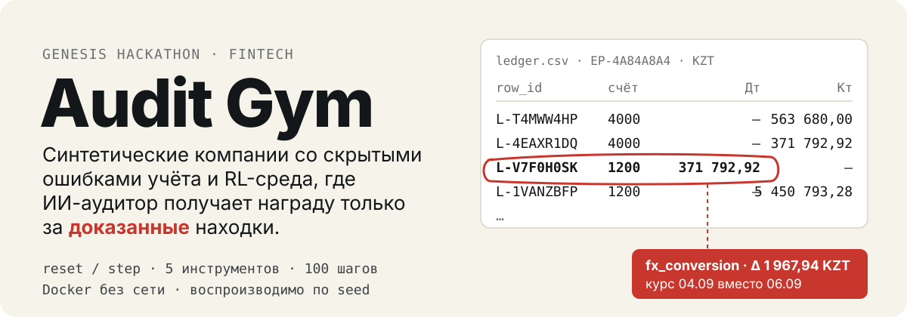
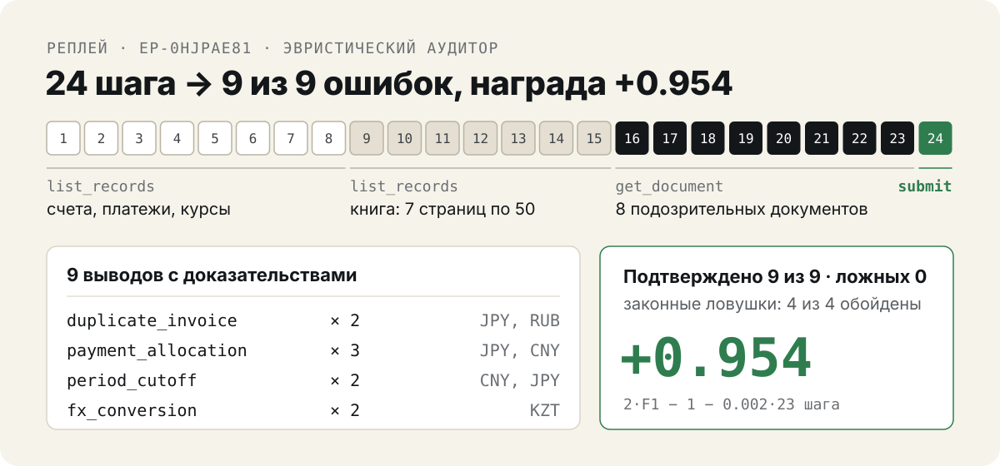
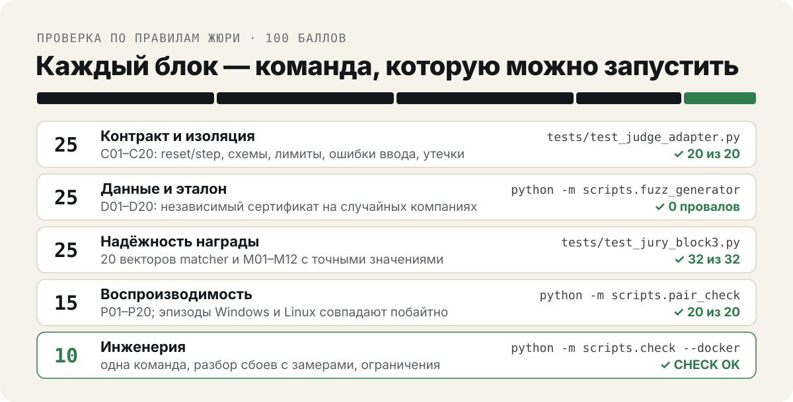

<p align="center">
  
</p>

# Audit Gym: RL-среда для дообучения ИИ-аудитора

**Команда:** The Best Viber Coders · **Трек:** Genesis Hackathon, FinTech · **Репозиторий:** https://github.com/mrzero-gh/The-best-Viber-coders

## Задача

ИИ-аудитора нужно учить на задачах, где правильный ответ известен заранее и проверяется без человека, а награду нельзя обмануть. Реальные бухгалтерские данные для этого не подходят: ошибки в них не размечены, а данные закрыты.

## Решение

**Генератор** по `seed` и конфигу создаёт месяц жизни вымышленной компании: главную книгу (200–2000 проводок), счета, платежи, курсы валют. Баланс Дт = Кт сходится всегда, даже после внесения ошибок, поэтому найти их можно только сверкой с документами. Ошибок четыре типа, каждый настраивается отдельно:
- дубликат счёта;
- неверное разнесение платежа;
- неверный курс конвертации;
- проводка не в том периоде.

Есть два совмещённых сценария и четыре вида законных «ловушек», похожих на ошибки: дробные платежи, возвраты, регулярные счета, документы в 23:xx по местному времени.

**Среда** работает в стиле Gymnasium (`reset`/`step`) в отдельном процессе. Агент видит данные только через 5 инструментов: `list_records`, `get_record`, `get_document`, `calculator`, `submit`. Лимиты: 100 шагов и 60 секунд на эпизод.

**Оценщик** сопоставляет выводы агента с эталоном через максимальное паросочетание и считает награду `clip(2·F1 − 1 − 0.002·шаги, −1, 1)`.

**Адаптер жюри** `judge_adapter.py` реализует интерфейс закрытой проверки: `generate_episode`, `make_env`, `score_episode`.

## Агент в деле

<p align="center">
  
</p>

## Почему награду нельзя обмануть

- «Пометить всё» даёт −1: ловушки есть даже в чистых компаниях.
- Повтор верного вывода не умножает баллы. ID и валюта сравниваются точно. Доказательство, которого нет в данных, превращает вывод в ложный.
- Эталон живёт только в процессе среды. Метки-канарейки проверяют, что он не утекает в наблюдения и траектории.
- Каждый эпизод проверяет независимый сертификат разрешимости. Oracle получает F1 = 1 везде, в том числе после перестановки строк и смены ID.

| Политика (`python -m scripts.jury`) | F1 | Награда | Шаги |
|---|---:|---:|---:|
| Oracle (знает эталон) | 1.000 | 1.000 | 1 |
| Умный аудитор по правилам | 1.000 | 0.963 | 19 |
| Наивный аудитор (без документов, время в UTC) | 0.704 | 0.386 | 16 |
| Случайная политика | 0.250 | −0.501 | 3 |
| «Пометить всё» | 0.000 | −1.000 | 2 |

## Проверка по правилам жюри

<p align="center">
  
</p>

Жюри скрывает seed, валюты, часовой пояс и размеры, поэтому генератор проверен на случайных значениях: любые компании и валюты (в том числе без копеек и с тремя знаками), эпизоды Windows и Linux совпадают байт в байт, узкие диапазоны размера, мусорные действия среды. Каждый найденный сбой описан с замером до и после и тестом-стражем ([записка о дизайне, раздел 6.5](design.md#65-найденные-и-исправленные-сбои-генератора)).

## Как проверить

```bash
python -m scripts.check --docker   # все тесты одной командой в контейнере без сети
python -m scripts.pair_check       # парные проверки как у жюри
python judge_adapter.py            # самопроверка адаптера жюри
```

Подробно: [README](../README.md), [записка о дизайне](design.md), [контракт](contract.md), [данные](DATA.md).
